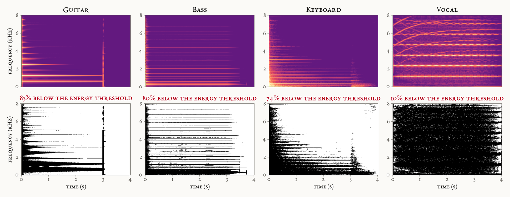
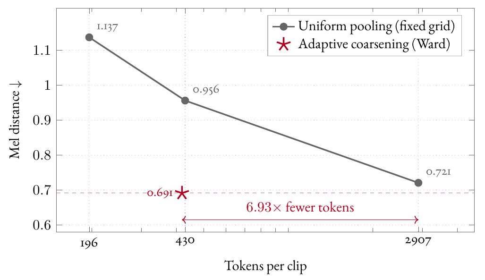
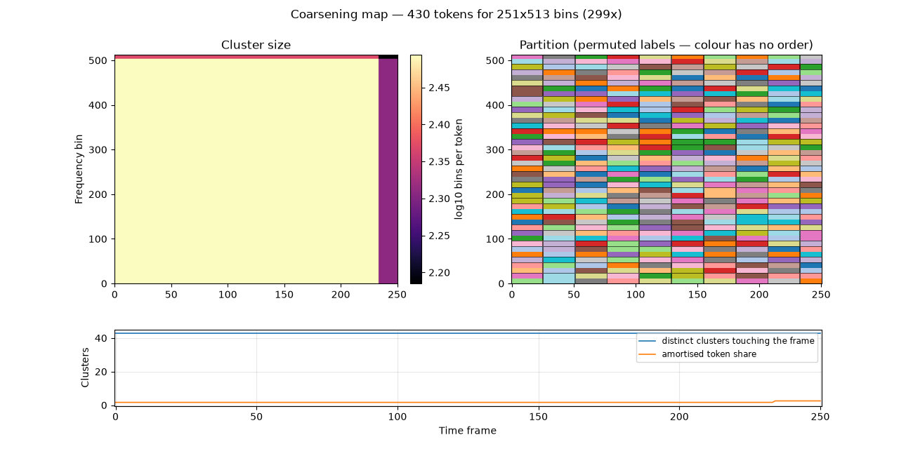
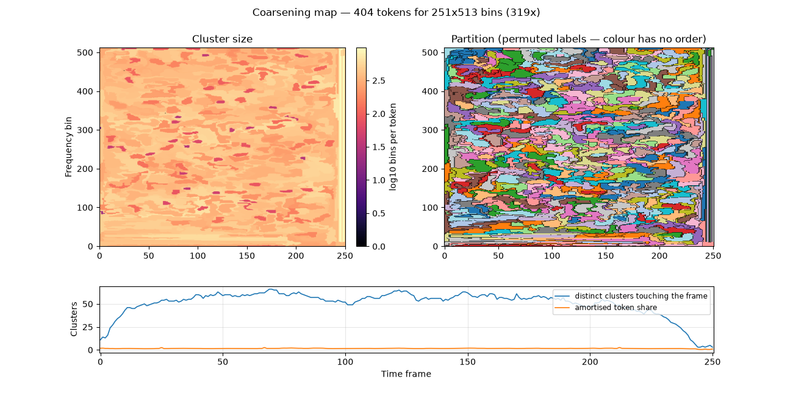

# An efficient latent representation of music based on graph neural networks

MSc thesis in Data Science, University of Padova (Department of Mathematics), academic year 2025–2026.

**Author:** Giovanni Chessa · **Advisor:** Prof. Antonio Rodà · **Co-advisor:** Matteo Spanio

**[Read the thesis (PDF)](Chessa_MSc_Thesis_2026.pdf)**

## In short

Neural audio codecs such as SoundStream, EnCodec and DAC cut audio into units whose shape is fixed by the architecture before any sound is heard. A held violin note, a drum hit and the silence after them all get the same treatment. This thesis asks whether the signal itself can decide how its time–frequency plane is divided.

The magnitude spectrogram of a clip is read as a graph: one node per time–frequency bin, 128,763 nodes for four seconds of audio. Six Chebyshev graph-convolution layers give each node the context of its neighbours, and a coarsening procedure then merges neighbouring regions until about 420 super-nodes remain, each one becoming a token. A graph decoder scatters the tokens back onto the grid and predicts the spectrogram, and the audio is resynthesised with Griffin–Lim. The whole model has 654,850 parameters.



*Why a fixed rate wastes tokens: a plucked guitar note leaves most of the plane empty, a sustained voice fills it, yet a fixed-rate encoder spends the same budget on both.*

## Main results

All experiments use NSynth (isolated musical notes, 4 s, 16 kHz).

- **The merge criterion decides the outcome.** Under a total-variation criterion the adaptive partition loses to a content-blind fixed grid. With a size-aware cost (Ward's linkage), which approximates the error the pooling will commit, it reconstructs 1.38× better at a matched token count.
- **Quality that a fixed grid does not reach with 6.7× more tokens.** The factor holds under the training objective on the validation set (6.93×) and under a Fréchet distance over CLAP embeddings on the 4,096 held-out test clips (6.7×), a metric neither system was trained on.
- **A blind listening test with 56 participants** (52 after a screening criterion fixed in advance) prefers the adaptive model to the rate-matched grid. The preference is small, +0.18 on a five-point scale, and the thesis reports where it holds and where it does not.
- **The CLAP-based metric tracks human ratings** (Pearson 0.79 among degraded systems), where the log-mel distance does not (−0.49).
- **Message passing does real work.** Removing it raises the reconstruction error by 65%, fourteen times the measured run-to-run noise.



*The adaptive model at about 420 tokens per clip reconstructs better than the fixed grid at 2,907 tokens. Both points were trained and measured; nothing is interpolated.*

| Fixed grid, 430 tokens | Adaptive coarsening, 404 tokens |
|---|---|
|  |  |

*The partitions the two methods produce on the same clip. The fixed grid uses identical cells everywhere; the adaptive cells vary in size by more than an order of magnitude and follow the structure of the note.*

## Code

The implementation is not public at the moment.

## License

The thesis is released under [CC BY-NC 4.0](https://creativecommons.org/licenses/by-nc/4.0/): you may share and adapt it, with credit to the author, for non-commercial purposes.

## Citation

```bibtex
@mastersthesis{chessa2026latent,
  author = {Giovanni Chessa},
  title  = {An efficient latent representation of music based on graph neural networks},
  school = {University of Padova},
  type   = {MSc thesis in Data Science},
  year   = {2026}
}
```
